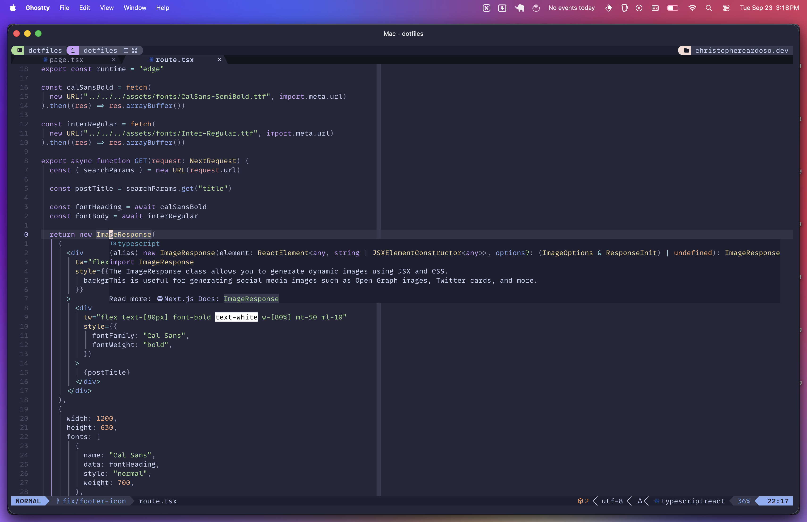
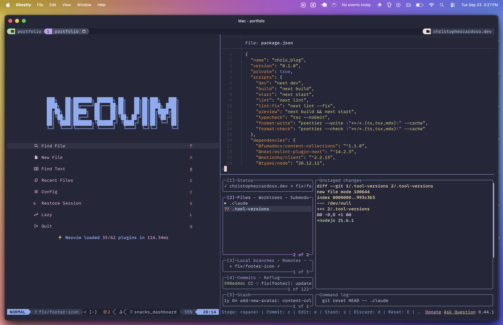

# Dotfiles

Modern development environment with one-command setup, Catppuccin Macchiato theming, and enhanced CLI tools.




## Requirements

Neovim ≥ 0.12 (uses `vim.lsp.config` and treesitter `main` branch). `tree-sitter-cli` is installed automatically via Brewfile to compile parsers locally.

## Quick Start

```bash
# Clone and setup everything
git clone https://github.com/kriscard/.dotfiles.git ~/.dotfiles
cd ~/.dotfiles
./dotfiles init
```

## Layout

```text
~/.dotfiles/
├── home/      # single GNU Stow package, maps directly to ~
├── AGENTS.md  # repo instructions for Pi and other coding agents
├── Brewfile   # Homebrew packages
├── dotfiles   # management CLI
└── scripts/   # setup helpers used by the CLI
```

## CLI Commands

| Command             | Purpose                       |
| ------------------- | ----------------------------- |
| `dotfiles init`     | Complete system setup         |
| `dotfiles update`   | Update dotfiles + packages    |
| `dotfiles packages` | Install Brewfile packages     |
| `dotfiles sync`     | Sync config symlinks (Stow)   |
| `dotfiles doctor`   | Health check & diagnostics    |
| `dotfiles backup`   | Backup existing configs       |
| `dotfiles macos`    | Apply macOS defaults          |
| `dotfiles ds_store` | Clean .DS_Store files         |

**Options:** `--dry-run` `--force` `--verbose`

```bash
# Examples
dotfiles doctor --verbose     # Detailed diagnostics
dotfiles sync --dry-run      # Preview changes
dotfiles backup              # Safe backup
```

`dotfiles doctor` exits with status 1 when a required tool is missing or a
Homebrew package-status query fails. Outdated packages and a non-Zsh login shell
are warnings. It checks CLI prerequisites and package status, not every app's
configuration.

`dotfiles backup` creates backups, but there is no automated restore command.
Inspect the backup and restore selected files manually.

Run the regression suite with `python3 scripts/test-doctor.py`. The tests use the
real CLI with disposable tool-availability fixtures and do not alter live config.

## Secret scanning

Install Gitleaks through `dotfiles packages` and enable the hooks with
`pre-commit install`. The hook scans staged Git contents with fully redacted
output, including cases where an unstaged edit hides a staged secret.

```bash
python3 scripts/test-secret-scanning.py
gitleaks git --pre-commit --staged --redact=100 --no-banner
gitleaks git --log-opts=--all --redact=100 --no-banner
```

The first scan is the commit check; the second scans committed history, including
removed secrets. `pre-commit run --all-files` does not turn the staged-content
hook into a history scan. CI runs the regression test and a full-history scan.
Ignored `.env` files are not scanned by these Git commands; keep them private.

## Claude security defaults

Claude settings remain machine-local. This opt-in helper preserves hooks, model
preferences, and unrelated permissions while tightening the audited defaults:

```bash
python3 scripts/harden-claude-settings.py         # Check only
python3 scripts/harden-claude-settings.py --apply # Private backup, then update
python3 scripts/test-claude-security.py
```

It disables blanket project MCP activation, clears the global project-server
allowlist, and moves seven broad interpreter/container/build approvals to prompts.
Those commands are not forbidden. Check-only mode returns status 1 when changes
are needed and never writes. Apply mode creates a mode-0600 backup, follows Stow
links without replacing them, and is idempotent. The existing settings file must
already exist; use `--settings /path/to/settings.json` for a nonstandard location.

Restart Claude after applying and approve trusted servers individually. Merging
this code does not apply it automatically, install servers, or change project
`.mcp.json` files. Permission prompts reduce accidental approval; they are not a
sandbox or a complete security audit.

## Neovim configuration checks

`[[` / `]]` navigate Treesitter class starts; `[r` / `]r` navigate references
through Snacks. The optional Node/Python/Ruby/Perl remote-plugin hosts are disabled
because no configured plugin needs them. This does not disable LSP servers or
DAP adapters; re-enable a host if a future plugin requires it.

```bash
nvim --headless -u NONE -l scripts/check-nvim-syntax.lua
bash scripts/test-nvim-audit.sh
```

CI compiles the configuration without loading plugins. The local integration
test uses installed plugins to verify provider flags, keymap ownership, and
Snacks input/select wiring after `UIEnter`. It does not sync or upgrade plugins.

## JavaScript debugging

nvim-dap connects directly to Mason's `js-debug-adapter`; the VS Code bridge and
retired `node2` adapter are no longer requested. On a fresh machine, load DAP and
let Mason's `js` installation complete, or run `:MasonInstall js-debug-adapter`.

```bash
bash scripts/test-javascript-dap.sh
```

This local smoke test uses installed plugins and a real temporary Node target:
launch, stop on entry, and evaluate an expression. It does not upgrade plugins.
Existing launch/attach/Jest configurations are preserved, but browser attach,
Jest, and TypeScript source maps still need project-specific checks.

## What's Included

### Core Tools

- **Neovim**: Lua config mostly for Frontend/Full-Stack developer LSP
- **Tmux**: Session management with vim keybindings
- **Terminal**: Kitty/Ghostty with Catppuccin Macchiato theme
- **Shell**: Zsh

### Modern CLI Tools

| Traditional | Replacement | Benefit                 |
| ----------- | ----------- | ----------------------- |
| `ls`        | `eza`       | Git integration & icons |
| `cat`       | `bat`       | Syntax highlighting     |
| `find`      | `fd`        | Faster & simpler        |
| `grep`      | `ripgrep`   | Blazing fast search     |
| `cd`        | `zoxide`    | Smart jumping           |

### Development Shortcuts

```bash
# Quick navigation
z project-name        # Jump to project (zoxide)
gcm "message"         # Git add + commit
killport 3000         # Kill process on port

# Tmux sessions
<prefix> + e          # Session launcher with Sesh Tmux Session Manager
<prefix> + Ctrl-s     # Save session
```

### Theming

Consistent Catppuccin Macchiato theme across all tools:

```bash
export THEME_FLAVOUR=macchiato  # frappe, latte, mocha
```
